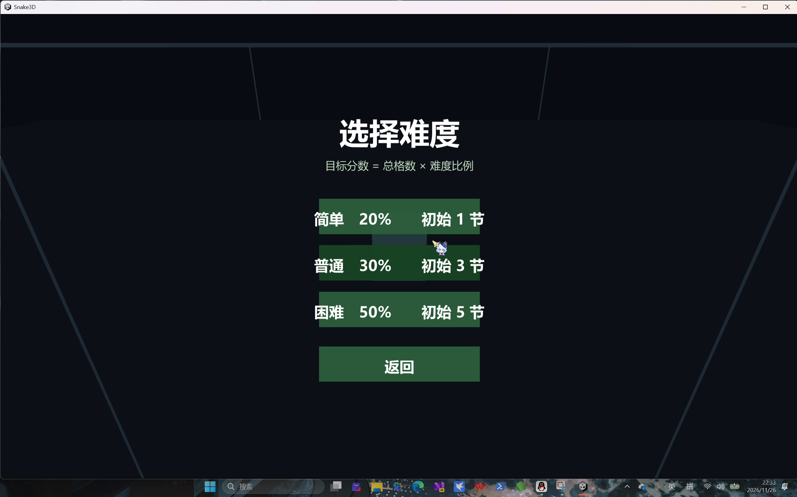
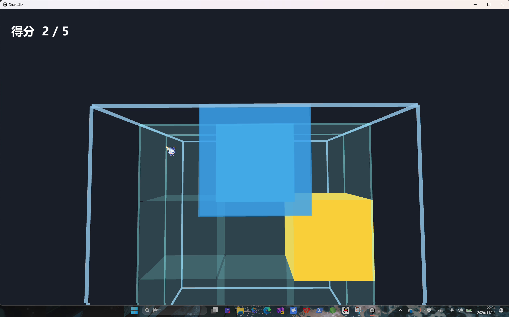

# 3D Snake (Unity)

A snake game that lives in a cube — you can move forward, sideways, **and up and down**.




[中文说明](README.md)

## Controls

| Input | Action |
|---|---|
| `A` / `D` | Turn left / right 90° relative to the current heading |
| `W` / `S` | Keep climbing / descending (press `A`/`D` to level out) |
| `Shift` | Boost — the body lights up |
| Left mouse drag | Orbit the camera (free view) |
| Mouse wheel | Zoom |
| `Esc` / `P` | Pause |
| `R` | Restart after game over |
| `L` | Toggle the layer highlight (debug) |

## Rules

- You spawn at the exact centre of the map. The starting length depends on difficulty (1 / 3 / 5 segments).
- The body grows segment by segment; eating food adds one more.
- Hitting a wall or your own body **does not kill you instantly** — the snake stops and a grace window opens (about one move interval). Turn into a free direction to escape; run out of time and the run ends.
- Reaching the target score wins the run.

## Difficulty & Maps

| Difficulty | Target score | Start length |
|---|---|---|
| Easy | 20% of all cells | 1 segment |
| Normal | 30% of all cells | 3 segments |
| Hard | 50% of all cells | 5 segments |

| Map | Food | Easy / Normal / Hard target |
|---|---|---|
| 3×3×3 | 1 | 5 / 8 / 14 |
| 5×5×5 | 2 | 25 / 38 / 63 |
| 7×7×7 | 3 | 69 / 103 / 172 |

## Features

- **Grid logic, smooth visuals** — the simulation steps one cell every 0.5 s while the renderer interpolates between cells; turns are only accepted on grid points.
- **A body that fills its path** — every visited cell has solid geometry, with extra filler blocks at corners, so the snake never shows gaps.
- **Fully procedural audio** — a 16-second looping soundtrack (chords, bass, melody, percussion) and every sound effect are synthesised at runtime. No audio assets in the repo.
- **Two camera modes** — a fixed third-person view that orbits the head on a circle (the head stays centred), or a free orbit view around the map.
- **Real-time lighting** — a directional light that follows the camera, a point light attached to the head, fog, soft shadows.
- **Layer highlight** — the horizontal layer containing the head is outlined with translucent blocks and a wireframe box, making height easy to judge.
- Settings (volumes, speed, camera responsiveness, view mode) persist through `PlayerPrefs`.

## Opening in Unity

1. Install **Unity 2022.3 LTS** (developed on 2022.3.62f3c1).
2. Unity Hub → Add → select this folder.
3. Open `Assets/Scenes/Game.unity`.
4. Press Play.

The scene is already wired up:

```
Main Camera   + CameraOrbit + LightFollowCamera + AudioListener
Directional Light
Game          + SnakeGame + MenuUI + AudioManager
```

## Building for Windows

From the editor menu:

```
Snake → Build Windows
```

Or headless, with the editor closed:

```bash
Unity.exe -batchmode -quit -projectPath "<repo path>" -executeMethod SnakeBuild.BuildWindows
```

Output goes to `Builds/Win64/Snake3D.exe`. `Snake → Setup Scene` regenerates a fully configured scene.

## Project layout

```
Assets/
├── Snake/
│   ├── SnakeGame.cs          Core: grid movement, collision, rendering, lighting, layer highlight
│   ├── MenuUI.cs             Code-built UI: menu, difficulty, map, settings, pause, results
│   ├── CameraOrbit.cs        Fixed and free camera modes
│   ├── LightFollowCamera.cs  Directional light that tracks the camera
│   ├── AudioManager.cs       Procedural music and sound effects
│   ├── GameSettings.cs       PlayerPrefs-backed settings
│   └── SliderReleaseSound.cs Plays a preview when a slider is released
├── Editor/SnakeBuild.cs      One-click scene setup + player build
└── Scenes/Game.unity         Ready-to-play scene
```

## License

MIT
