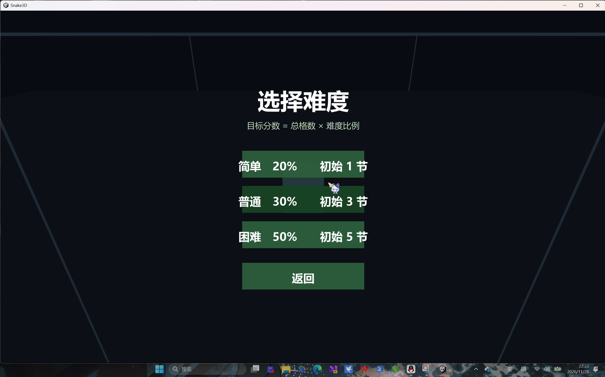
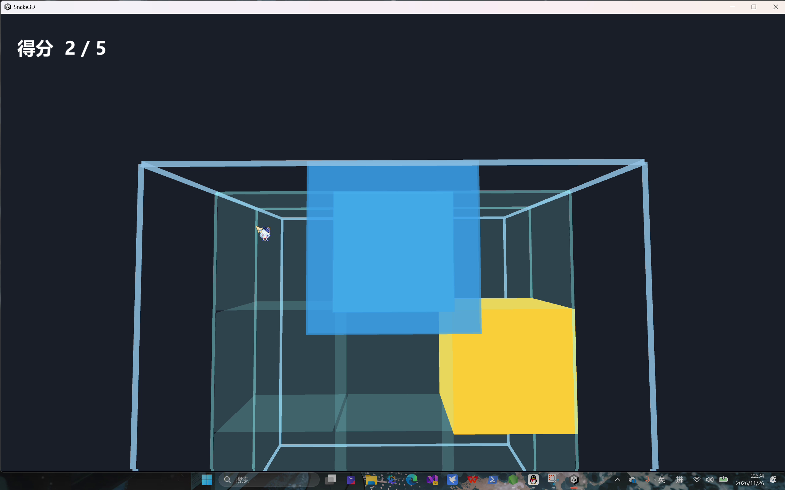

# 3D 贪吃蛇（Unity）

[English](README.en.md)

一个跑在立方体空间里的贪吃蛇：不只有前后左右，还能上下飞。




## 下载

Windows 64 位（解压后双击 `Snake3D.exe`，无需安装 Unity）：

**[下载 v0.9](https://github.com/Pwn-pan/snake-3D/releases/latest)**（25 MB）

## 玩法

| 操作 | 作用 |
|---|---|
| `A` / `D` | 相对当前朝向，向左 / 向右转 90° |
| `W` / `S` | 持续上升 / 下降（按 `A`/`D` 恢复平飞） |
| `Shift` | 加速（身体会高亮） |
| 鼠标左键拖动 | 自由视角下旋转镜头 |
| 滚轮 | 镜头远近 |
| `Esc` / `P` | 暂停 |
| `R` | 结束后重开 |
| `L` | 开关「层高亮」（调试用） |

规则：

- 出生在地图正中心，初始长度由难度决定（1 / 3 / 5 节）
- 身体逐节长出，吃到食物变长
- 撞墙或咬到自己 → 停住并进入宽限期（约一个移动间隔），期间转向可脱离，超时判定失败
- 达到目标分数即胜利

## 难度与地图

| 难度 | 目标分 | 初始长度 |
|---|---|---|
| 简单 | 总格数 × 20% | 1 节 |
| 普通 | 总格数 × 30% | 3 节 |
| 困难 | 总格数 × 50% | 5 节 |

| 地图 | 食物数 | 简单 / 普通 / 困难 目标分 |
|---|---|---|
| 3×3×3 | 1 | 5 / 8 / 14 |
| 5×5×5 | 2 | 25 / 38 / 63 |
| 7×7×7 | 3 | 69 / 103 / 172 |

## 特性

- **网格移动 + 平滑渲染**：逻辑每 0.5 秒走一格，视觉在格间插值，转向只在格点生效
- **身体铺满路径**：走过的每一格都有实体，拐角处额外补块，不会露缝
- **程序生成的音频**：16 秒循环 BGM（和弦 + 贝斯 + 旋律 + 打击）与全部音效都是实时合成，仓库里没有音频素材
- **两种镜头**：固定视角（圆形轨道跟随蛇头，蛇头始终居中）/ 自由视角（环绕地图中心）
- **光影**：实时方向光跟随相机、点光跟随蛇头、雾效、软阴影
- **层高亮**：蛇头所在水平层用半透明方块 + 外框标出，方便判断高度
- 设置项（音量 / 速度 / 镜头跟随速度 / 视角）用 `PlayerPrefs` 持久化

## 用 Unity 打开

1. 安装 **Unity 2022.3 LTS**（本项目在 2022.3.62f3c1 上开发）
2. Unity Hub → Add → 选择本仓库目录
3. **首次打开需要 1–2 分钟**（Unity 生成 `Library/` 并导入资源，属正常现象）
4. 打开 `Assets/Scenes/Game.unity`
5. 点 Play

场景里已经配好三个物体：

```
Main Camera   + CameraOrbit + LightFollowCamera + AudioListener
Directional Light
Game          + SnakeGame + MenuUI + AudioManager
```

## 打包 Windows 版

菜单栏：

```
Snake → Build Windows
```

或者命令行（关掉编辑器后执行）：

```bash
Unity.exe -batchmode -quit -projectPath "<仓库路径>" -executeMethod SnakeBuild.BuildWindows
```

输出到 `Builds/Win64/Snake3D.exe`。

执行 `Snake → Setup Scene` 可以重新生成一个配置好的场景。

## 项目结构

```
Assets/
├── Snake/
│   ├── SnakeGame.cs          核心：网格移动、碰撞、渲染、光影、层高亮
│   ├── MenuUI.cs             代码生成的 UI：菜单、难度、地图、设置、暂停、结算
│   ├── CameraOrbit.cs        固定/自由两种镜头
│   ├── LightFollowCamera.cs  方向光跟随相机
│   ├── AudioManager.cs       程序合成 BGM 与音效
│   ├── GameSettings.cs       PlayerPrefs 设置
│   └── SliderReleaseSound.cs 滑块松手试听
├── Editor/SnakeBuild.cs      一键生成场景 + 打包
└── Scenes/Game.unity         可直接运行的场景
```

## 许可

MIT
